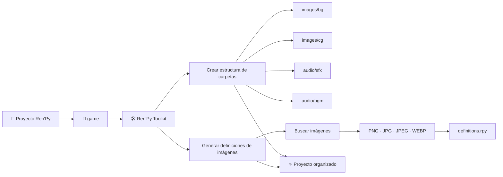
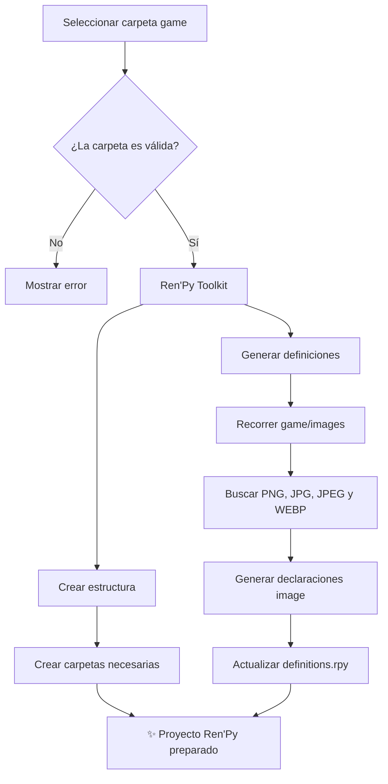
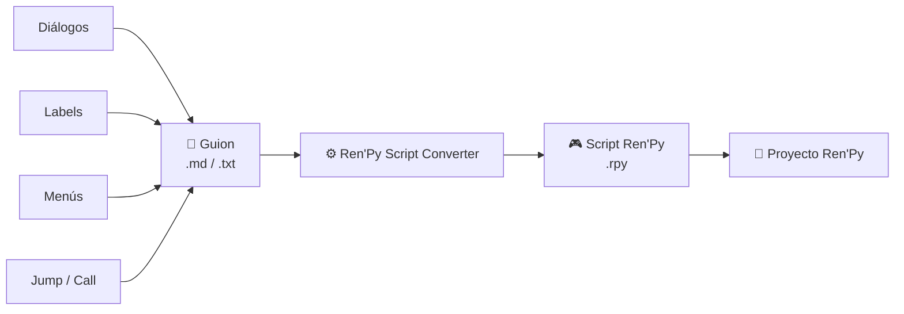

### Ren'Py Toolkit

[▶️ Ver tutorial en YouTube](https://youtu.be/ijLl-BmRSkM)

Ren'Py Toolkit es una herramienta de escritorio para Windows que automatiza algunas tareas repetitivas de organización y configuración de proyectos desarrollados con Ren'Py.

No necesitas modificar manualmente los archivos del proyecto para utilizar sus funciones principales.

El funcionamiento general de la herramienta puede resumirse así:



La herramienta trabaja directamente sobre la carpeta `game` que seleccione el usuario.

---

#### 1. Crear estructura de carpetas

Esta función crea automáticamente una estructura básica para organizar los recursos del proyecto:

```text
game/
├── images/
│   ├── bg/
│   └── cg/
└── audio/
    ├── sfx/
    └── bgm/
```

Cada carpeta tiene un propósito específico:

|Carpeta|Uso|
|---|---|
|`images/bg`|Fondos de las escenas|
|`images/cg`|Ilustraciones y CGs|
|`audio/sfx`|Efectos de sonido|
|`audio/bgm`|Música de fondo|

El script comprueba si las carpetas ya existen antes de crearlas.

Por lo tanto, si una carpeta ya existe, **no se elimina ni se modifica su contenido**.

Esto permite ejecutar la función posteriormente sin tener que preocuparse por perder archivos existentes.

---

#### 2. Generar definiciones de imágenes

Esta función automatiza la creación de declaraciones `image` de Ren'Py.

Normalmente, una imagen puede declararse manualmente de esta manera:

```renpy
image bg cafeteria = "images/bg/cafeteria.png"
```

Cuando un proyecto comienza a tener muchas imágenes, escribir cada definición manualmente puede convertirse en una tarea repetitiva.

Ren'Py Toolkit automatiza este proceso.

#### Funcionamiento

El script comienza recorriendo la carpeta:

```text
game/images
```

También revisa sus subcarpetas.

Por ejemplo:

```text
game/
└── images/
    ├── bg/
    │   ├── cafeteria.png
    │   └── parque.jpg
    │
    └── cg/
        └── confession.webp
```

El programa detecta automáticamente los archivos de imagen compatibles:

```text
.png
.jpg
.jpeg
.webp
```

Después genera las declaraciones correspondientes.

Por ejemplo:

```renpy
image bg cafeteria = "images/bg/cafeteria.png"
image bg parque = "images/bg/parque.jpg"
image cg confession = "images/cg/confession.webp"
```

Estas definiciones se almacenan en:

```text
game/images/definitions.rpy
```

---

#### 3. ¿Cómo evita modificar otras partes del archivo?

El archivo `definitions.rpy` utiliza dos marcadores:

```text
# AUTO START
# AUTO END
```

El contenido generado automáticamente se encuentra entre estos dos puntos:

```renpy
# AUTO START

image bg cafeteria = "images/bg/cafeteria.png"
image bg parque = "images/bg/parque.jpg"
image cg confession = "images/cg/confession.webp"

# AUTO END
```

Cuando se vuelve a ejecutar la herramienta, el script puede identificar esta sección y actualizar únicamente el contenido generado automáticamente.

Esto permite agregar o eliminar imágenes del proyecto y volver a generar las definiciones sin tener que escribirlas una por una.

Si `definitions.rpy` todavía no existe, Ren'Py Toolkit puede crearlo automáticamente con la estructura necesaria.

---

#### 4. Flujo completo

El proceso puede resumirse de la siguiente manera:



#### 5. La herramienta trabaja localmente

Ren'Py Toolkit realiza estas operaciones directamente sobre los archivos del proyecto seleccionado.

No es necesario subir el proyecto a un servidor para:

- crear carpetas;
    
- buscar imágenes;
    
- generar definiciones;
    
- actualizar `definitions.rpy`.
    

La herramienta está diseñada para funcionar localmente en el equipo del usuario.

---

#### En resumen

Ren'Py Toolkit busca reducir el trabajo repetitivo durante el desarrollo de una novela visual.

```text
                 REN'PY TOOLKIT
                       │
          ┌────────────┴────────────┐
          │                         │
          ▼                         ▼
 Crear estructura             Generar imágenes
   de carpetas                  automáticamente
          │                         │
          ▼                         ▼
   ┌─────────────┐            ┌──────────────┐
   │ images/     │            │ definitions  │
   │ audio/      │            │    .rpy      │
   └─────────────┘            └──────────────┘
          │                         │
          └────────────┬────────────┘
                       ▼
              ✨ Proyecto organizado
```

El objetivo no es reemplazar Ren'Py ni modificar la lógica del juego, sino **automatizar tareas de organización que normalmente tendrían que realizarse manualmente**.


**Repo:** [Ren'Py Toolkit en GitHub](https://github.com/GabffeeDev/definition-tool)

#### Pasos de instalación y descarga:
 1. En releases ir a **Ren'Py Definition Tool v1.0.0** y descargar **[RenPyToolkit.rar](https://github.com/GabffeeDev/definition-tool/releases/download/v1.0.0/RenPyToolkit.rar)**
 2. Descomprimir el .rar
 3. Ejecutar el .exe (Les dirá que es de un editor desconocido solo ignórenlo)

---

### Ren'Py Script Converter

[▶️ Ver tutorial en YouTube](https://youtu.be/Xn_XdZi8jSM)

**Ren'Py Script Converter** es una herramienta que permite escribir y organizar guiones de novelas visuales utilizando una sintaxis sencilla inspirada en Markdown y Obsidian, para después convertirlos automáticamente en scripts compatibles con Ren'Py (`.rpy`).

La idea principal es separar el proceso de **escritura de la historia** del proceso de **programación**.

**[Repositorio oficial de Ren'Py Script Converter →](https://github.com/GabffeeDev/renpy-script-converter)**

#### ¿Cómo funciona?

El flujo de trabajo de la herramienta puede resumirse así:



En lugar de escribir directamente estructuras como:

```
label inicio:

    "La puerta se abrió lentamente."

    menu:
        "Entrar":
            jump interior

        "Irse":
            jump exterior
```

puedes escribir el guion utilizando la sintaxis del conversor y dejar que la herramienta genere automáticamente la estructura equivalente de Ren'Py.

---

### Instalación

#### 1. Descargar el programa

Accede al repositorio oficial:

**[Ren'Py Script Converter en GitHub →](https://github.com/GabffeeDev/renpy-script-converter)**

Busca el archivo:

[ConversorRenpy.rar](https://github.com/GabffeeDev/renpy-script-converter/releases/download/v1.0.0/ConversorRenpy.rar)
```
ConversorRenpy.rar
```

Este archivo contiene la versión empaquetada de la aplicación para Windows.

#### 2. Extraer el archivo

Después de descargar `ConversorRenpy.rar`, extrae su contenido utilizando un programa compatible con archivos `.rar`, como 7-Zip o WinRAR.

Después de extraerlo deberías encontrar el ejecutable:

```
ConversorRenpy.exe
```

#### 3. Ejecutar la aplicación

Haz doble clic sobre:

```
ConversorRenpy.exe
```

No necesitas instalar Python para utilizar esta versión empaquetada.

La aplicación se ejecutará directamente en Windows.